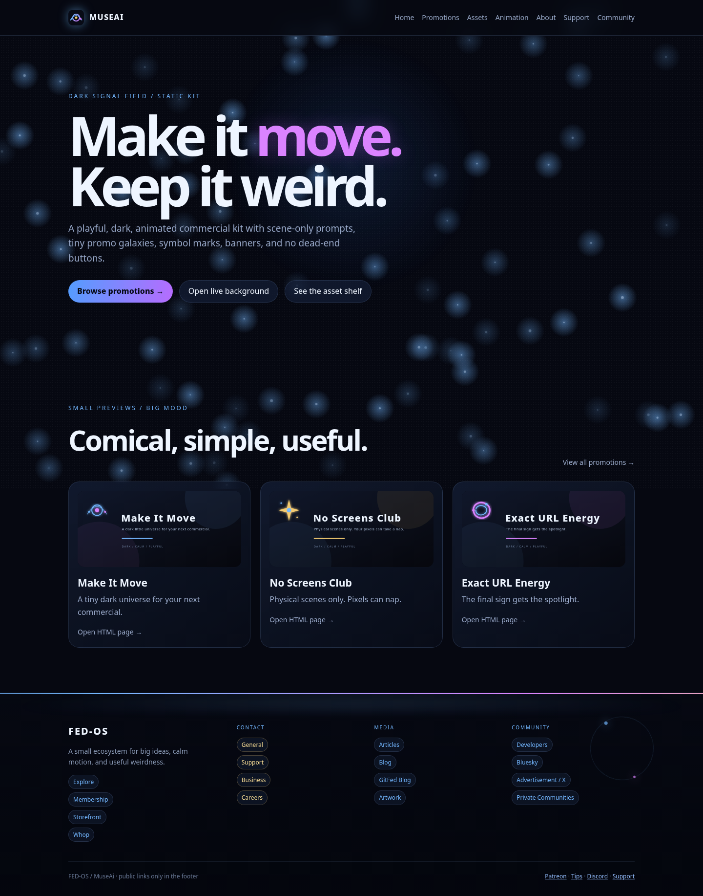
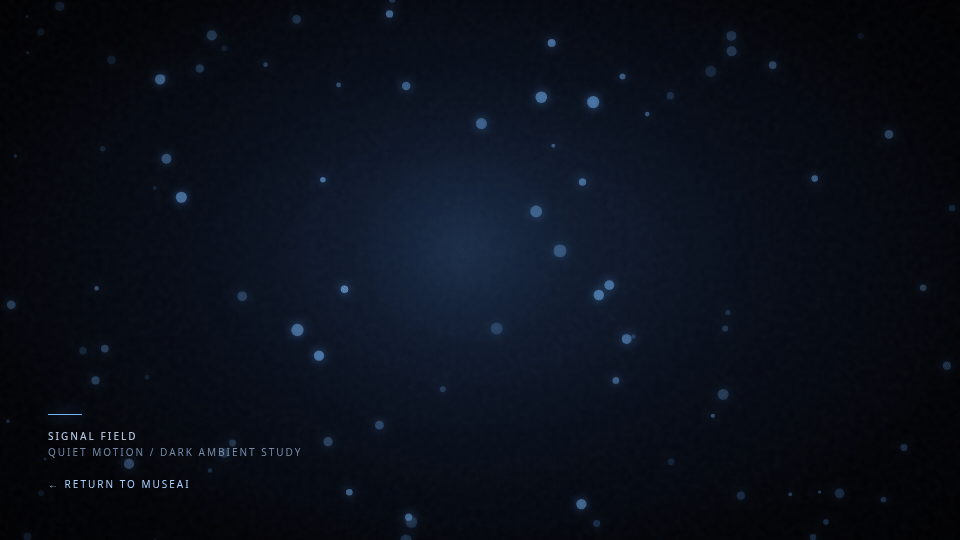
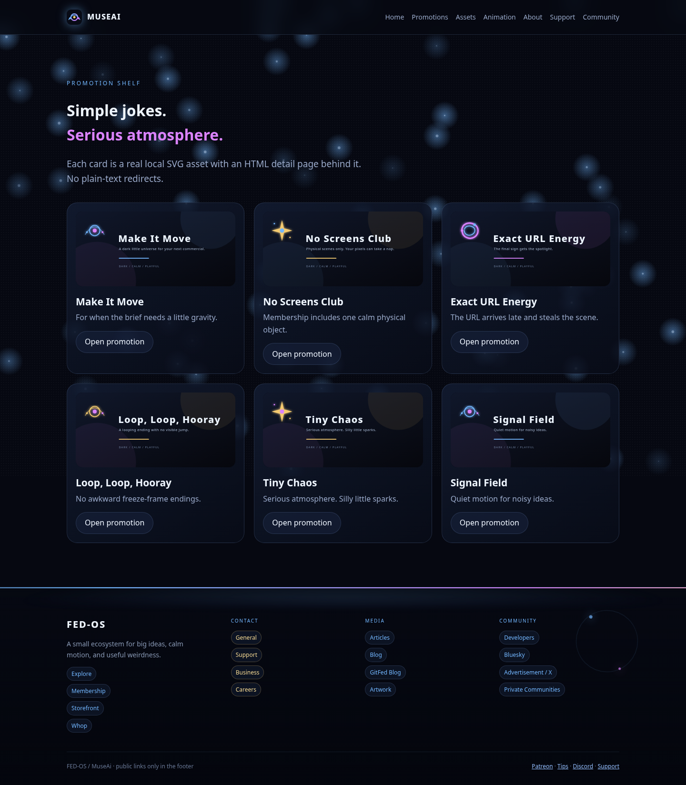
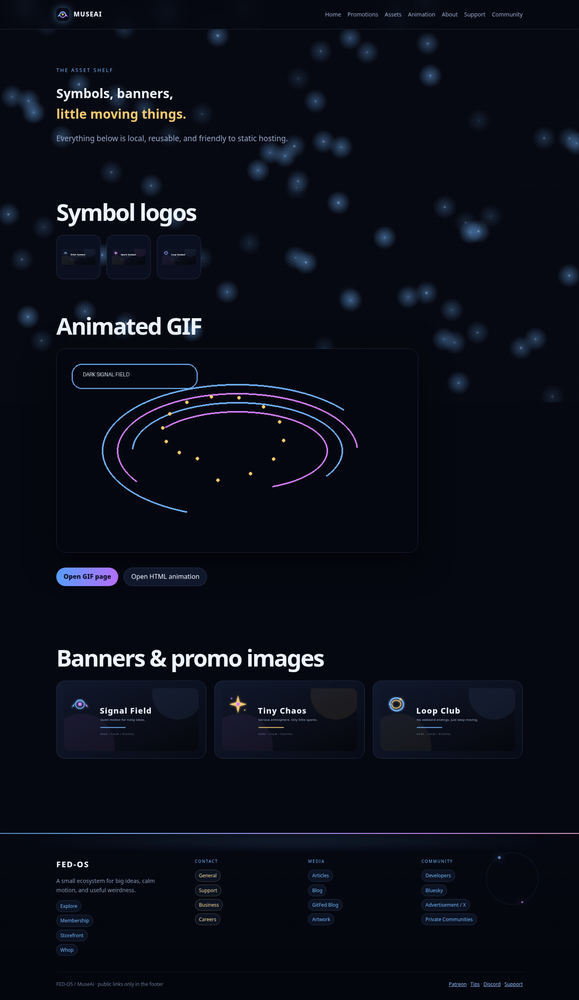
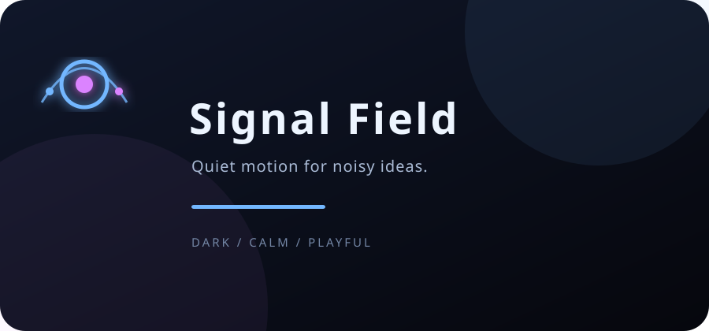
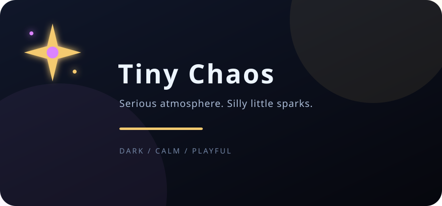
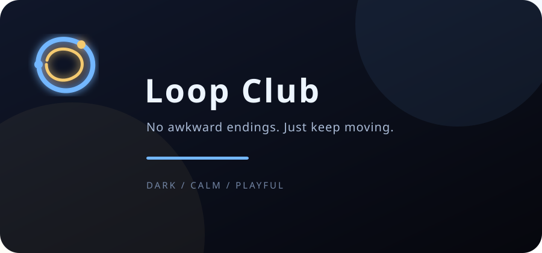
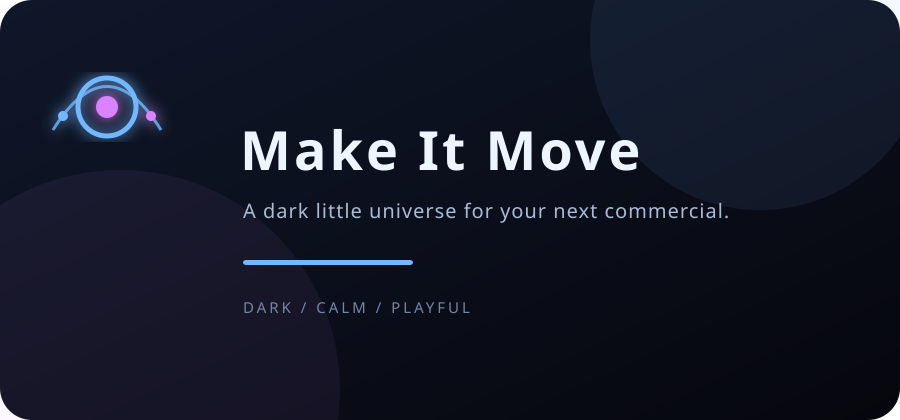
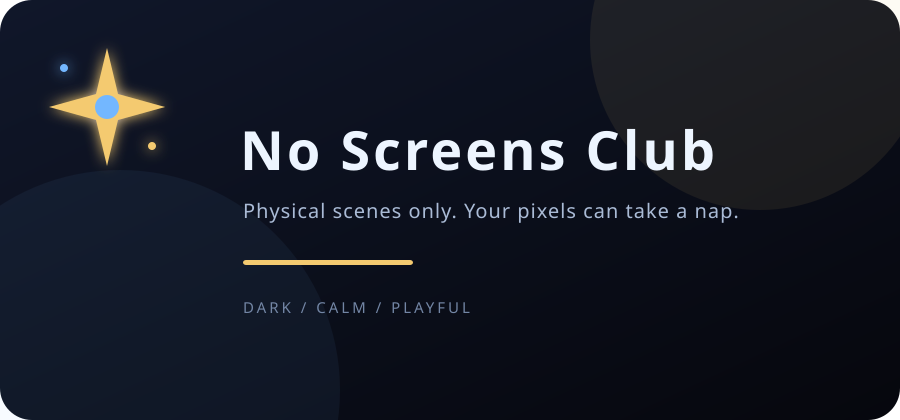
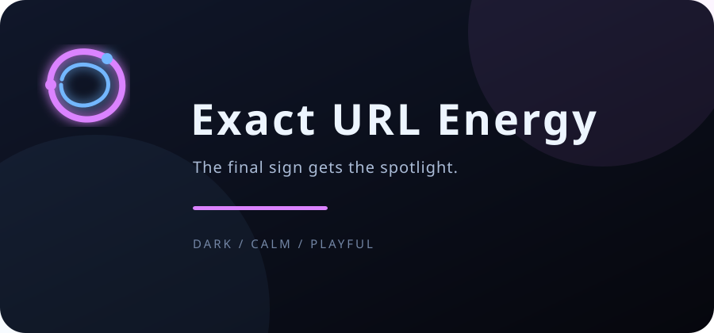

# MuseAi / FED-OS

[](LICENSE.md) [](#quick-start)

A no-build static microsite and reusable scene-only commercial kit for making dark, calm, animated promotions that stay physical, readable, and easy to frame-check.



## Why this exists

Commercial-generation prompts often become vague concept art. A phrase such as “show how the product transforms work” gives a generator too much to invent: screens appear, text becomes garbled, logos mutate, and the final URL is wrong.

MuseAi makes the repeatable parts explicit. The prompt describes only places, objects, and physical actions a camera can film. The concept sentence stays in the human brief. Exact copy waits for the final sign. A small set of frame-check rules catches screens, logos, early text, people in the wrong place, and URL errors before a take ships.

The repository also contains the actual static front end for the kit: an animated dark landing page, promotional cards, banners, symbol logos, a GIF, support and community pages, and a gated private-communities flow. It is intentionally plain HTML, CSS, JavaScript, SVG, and GIF—no package manager or build step required.

## See it work

There is **no live demo URL configured in this repository**, and no GitHub Pages or Cloudflare deployment workflow was found. The Join page uses the supplied Supabase project and requires internet access; its CDN/auth dependency is intentionally external. The quickest real demo is local:

```bash
python3 -m http.server 8000
```

Then open [http://localhost:8000/](http://localhost:8000/) and choose **Browse promotions**, **Open live background**, or **See the asset shelf**. For the fastest single-file demo, open [`background/index.html`](background/index.html) directly in a browser.

### Real demo capture

This GIF is a short capture of the working canvas animation in `background/index.html`—not a mockup:



Main reference example: [Forms / Signal Field frame-check record](examples/forms-signal-field.md).

## Screenshots

These screenshots were captured from the local HTML application included in this repository.

| Homepage and animated footer | Promotion shelf |
|---|---|
|  |  |



## Promotional artwork

The visual assets are local files, so the README and the static site do not depend on an image CDN. The same assets are used by the HTML pages.

| Signal Field | Tiny Chaos | Loop Club |
|---|---|---|
|  |  |  |

| Make It Move | No Screens Club | Exact URL Energy |
|---|---|---|
|  |  |  |

More assets are available in [`assets/`](assets/) and in the live local [asset shelf](pages/assets.html).

## Quick start

### Run the static site

```bash
# from the repository root
python3 -m http.server 8000
# visit http://localhost:8000/
```

The site uses relative links and can be served as a static directory by GitHub Pages or Cloudflare Pages, but deployment is not configured here. There is no `package.json`, bundler, server runtime, or required install step.

### Use the commercial kit

```bash
# fill in a brief
cp templates/product-brief.md briefs/my-product.md

# inspect a generated video
python3 scripts/verify_video.py path/to/take.mp4

# extract the five frame-check moments
python3 scripts/frame_check.py path/to/take.mp4
```

The scripts require FFmpeg and FFprobe on `PATH`. They report facts and extract frames; human review follows [`prompts/FRAME-CHECK.md`](prompts/FRAME-CHECK.md).

### Verify the repository files

```bash
python3 -m py_compile scripts/verify_video.py scripts/frame_check.py
bash -n scripts/gif_export.sh
```

## What is included

- [`index.html`](index.html) — the real static-site entry point.
- [`background/index.html`](background/index.html) — the interactive dark canvas background with particles, glow, pointer response, and reduced-motion support.
- [`pages/promotions.html`](pages/promotions.html) — six promotional cards with individual HTML detail pages.
- [`pages/assets.html`](pages/assets.html) — local logos, banners, promo art, and the animated GIF.
- [`pages/animation.html`](pages/animation.html) — an embedded live animation preview.
- [`pages/join.html`](pages/join.html) — Supabase-backed email-list sign-up/sign-in widget with password reset, session state, logout, and animated placeholder text.
- [`pages/support.html`](pages/support.html) — age-gated subscription and donation integrations supplied for PayPal, Stripe, GitHub Sponsors, Ko-fi, Buy Me a Coffee, and NOWPayments.
- [`pages/discord.html`](pages/discord.html) — Discord community buttons and widget, with an 18+ email-request flow that does not directly reveal the adult invite.
- [`pages/private-communities.html`](pages/private-communities.html) — age- and country-gated Matrix access; the restricted link is not placed in the public footer.
- [`prompts/`](prompts/) — the generic commercial prompt, hard rules, frame-check procedure, and worked reference.
- [`templates/`](templates/) — product brief and final-sign templates.
- [`scripts/`](scripts/) — video metadata verification, frame extraction, and GIF export recipe.
- [`docs/`](docs/) — method, deviations, defects, release checklist, and scene-only rationale.
- [`briefs/`](briefs/) — filled and partially filled product briefs.
- [`assets/`](assets/) — symbol-only favicon, logos, banners, promotional SVGs, screenshots, and demo GIF.

## The method in one minute

1. Fill in [`templates/product-brief.md`](templates/product-brief.md).
2. Copy the values into [`prompts/COMMERCIAL-TEMPLATE.md`](prompts/COMMERCIAL-TEMPLATE.md).
3. Generate a scene-only take: physical scenes, no concept sentence.
4. Frame-check at 10%, 50%, 70%, 80%, and 95% of the video duration.
5. Confirm zero screens, zero logos, no early text, exact final URL, and correct people placement.
6. Name deviations plainly. Redo hard-rule defects instead of hiding them.

## Project status and deployment

This is a local, static project package. The repository currently has:

- a working HTML entry point;
- real local promotional assets and screenshots;
- no build system;
- no package manifest;
- no CI workflow;
- no GitHub Pages configuration;
- no Cloudflare Pages configuration;
- no verified live deployment URL.

That makes the project easy to deploy, but deployment still needs to be enabled in the target GitHub or Cloudflare project.

## License

MIT. See [`LICENSE.md`](LICENSE.md).
